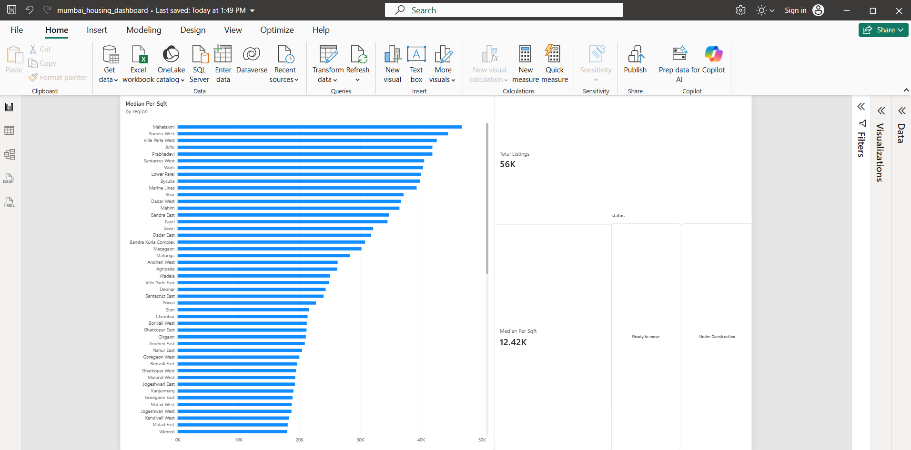
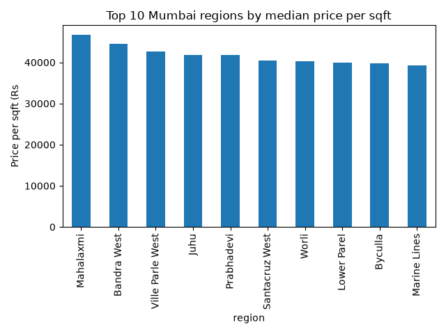
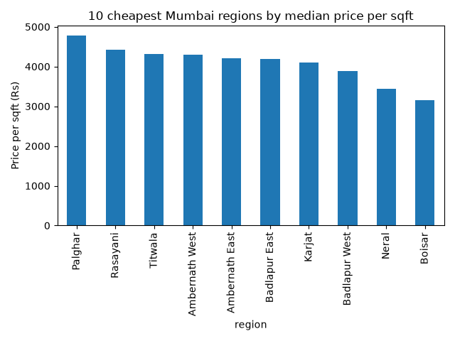
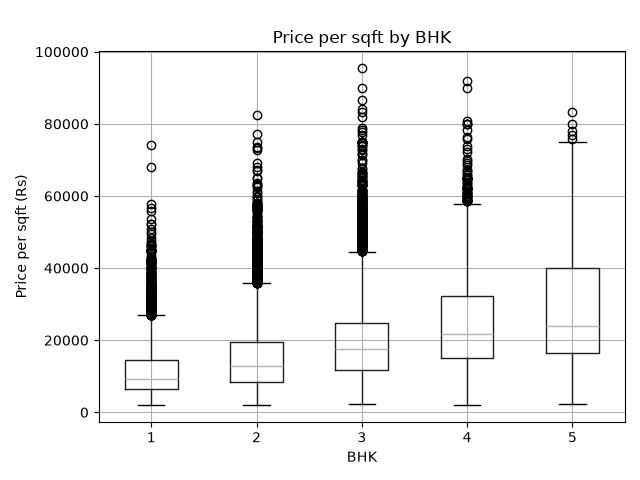
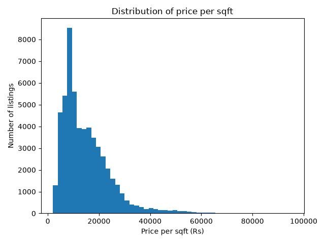

# Mumbai House Prices Analysis

An end-to-end data analytics project on Mumbai property listings. I cleaned the raw data in Excel, loaded it into PostgreSQL, explored it with SQL and pandas, and built a Power BI dashboard on top of a SQL view.

## Dataset

- Source: Kaggle, "Mumbai House Prices" by dravidvaishnav
- Size: 76,038 rows in the raw file
- Columns: `bhk`, `type`, `locality`, `area`, `price`, `price_unit`, `region`, `status`, `age`
- Note: the data looks like it was scraped in early 2023, so prices are not current. These are listing prices, not confirmed sale prices.

## Tools used

| Tool | What I used it for |
|---|---|
| Excel | First look at the data, cleaning, unit conversion, first pivot tables |
| PostgreSQL | Stored the clean data, wrote group-by queries, created a view for the dashboard |
| Python (pandas, matplotlib) in VS Code | Median check, charts, outlier check |
| Power BI Desktop | Dashboard connected to the PostgreSQL view |

## Data cleaning

1. **Duplicates:** removed 20,312 exact duplicate rows (about 27% of the file), leaving 55,726. There is no listing ID, so some of these could be genuinely identical flats in the same building. I decided to remove them because inflated counts would distort the averages.
2. **Price units:** prices were in either Lakh (L) or Crore (Cr). I converted everything to Lakh (1 Cr = 100 L) into a new column `price_in_lakh`.
3. **Price per sqft:** created `price_per_sq_ft = price_in_lakh x 100,000 / area`.
4. **Suspect rows:** flagged and excluded 22 rows with price per sqft below Rs 2,000 or above Rs 1,00,000. Many looked like entry errors (for example, a 2 BHK in Thane West listed at 16.5 Cr, which looks like a misplaced decimal). The cutoffs are a rough rule, not a perfect one.
5. **Final dataset:** 55,704 rows.
6. **Column issue:** the `locality` column actually holds building/project names, so I used `region` for all area-level analysis.
7. **Small groups:** regions with fewer than 30 listings are left out of rankings, because averages from a handful of listings are unreliable.

## Key findings

**1. Huge price gap between regions.**
By median price per sqft, the most expensive regions are Mahalaxmi (about Rs 46,700), Bandra West (about Rs 44,400), Ville Parle West (about Rs 42,600), Juhu and Prabhadevi (both about Rs 41,900). The cheapest are Boisar (about Rs 3,150), Neral (about Rs 3,440), Badlapur West (about Rs 3,900), Karjat (about Rs 4,100) and Badlapur East (about Rs 4,200). Mahalaxmi is roughly 15x more expensive per sqft than Boisar. The cheapest regions are all far outer areas.

**2. Bigger flats cost more per sqft, but location matters more.**
Average price per sqft rises from about Rs 11,100 (1 BHK) to about Rs 29,400 (5 BHK). However, the box plot shows heavy overlap between BHK groups, and bigger flats may also sit in pricier areas, so BHK is not the whole story.

**3. Under-construction flats are not always more expensive.**
Across the whole city, under-construction flats average about 11% more per sqft than ready-to-move flats (about Rs 15,900 vs Rs 14,300). Checking inside single regions shows it depends on the area: in Andheri West there was almost no gap, while in Thane West under-construction flats were about 18% higher.

**4. Property type.**
About 98% of listings are apartments. Studio apartments are cheaper per sqft (about Rs 9,650 vs about Rs 15,000 for apartments). Villas, independent houses and penthouses have too few listings to compare.

**5. Averages vs medians.**
Prices are skewed towards the expensive end, so the median is lower than the average in most regions. The overall median is about Rs 12,400 per sqft. Rankings by mean and median agree at the top and bottom, apart from one swap near the top (Worli dropped out of the median top 5 and Ville Parle West came in).

## Project files

| File | Description |
|---|---|
| `mumbai_houses.xlsx` | Excel workbook with the cleaning steps and first pivots |
| `Mumbai_House_Prices_Clean.csv` | Cleaned data used for loading |
| `queries.sql` | Table creation, view and analysis queries |
| analysis notebook / script | pandas analysis and charts |
| `mumbai_housing_dashboard.pbix` | Power BI dashboard |
| `*.png` | Charts and dashboard screenshot |

## How to reproduce

1. Create a PostgreSQL database `mumbai_housing` and a table `mumbai_houses` using the `CREATE TABLE` statement in `queries.sql`.
2. Import `Mumbai_House_Prices_Clean.csv` with the header option turned on.
3. Create the `houses_clean` view from `queries.sql`.
4. Open the Python analysis and run the cells in order (needs pandas and matplotlib).
5. Open the `.pbix` in Power BI Desktop and point it at your local PostgreSQL database.
